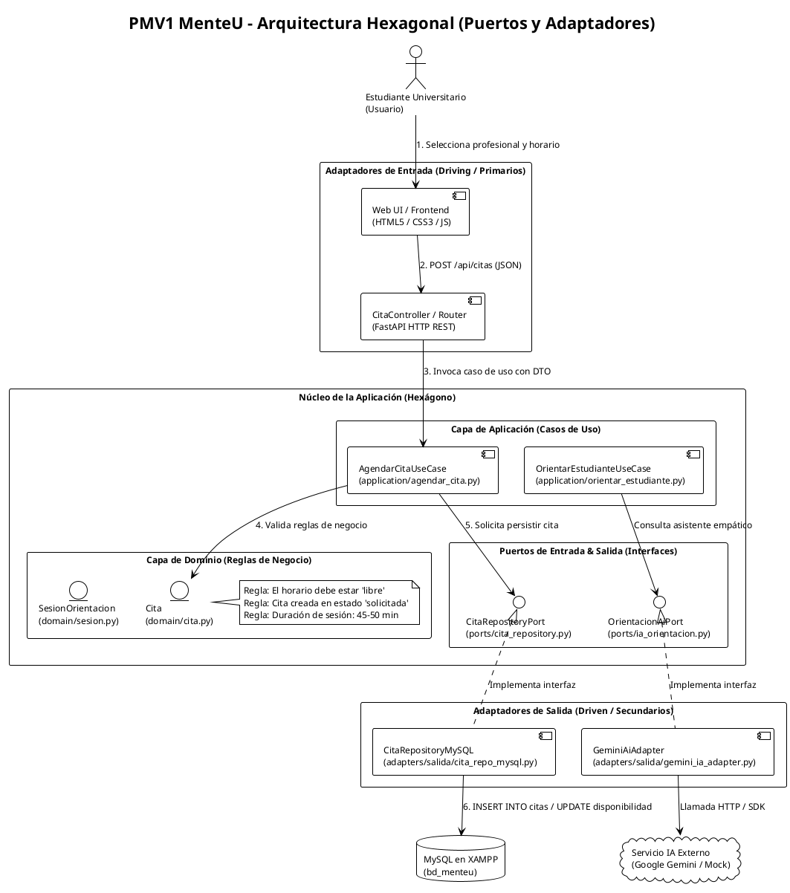
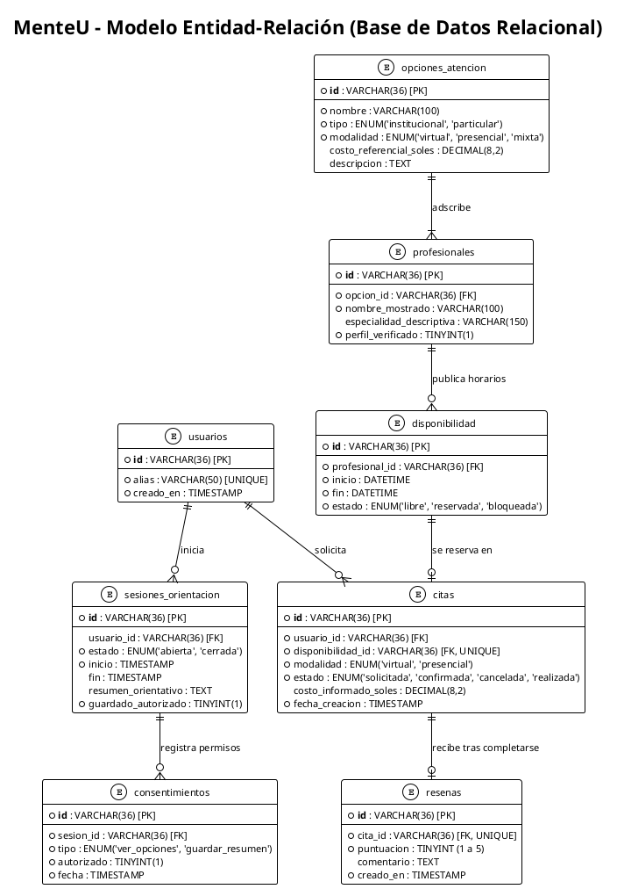

# GUÍA DE TRABAJO 10: PMV1 Y PDCA
## PROYECTO: MenteU — Plataforma de Orientación y Apoyo Emocional Universitario
### CURSO: Diseño de Productos y Servicios

---

# ACTIVIDAD 1: DISEÑO DE LA SOLUCIÓN TECNOLÓGICA

---

## 1.1. SELECCIÓN DE ARQUITECTURA

Para el desarrollo del Producto Mínimo Viable 1 (PMV1) de la plataforma **MenteU**, se compararon dos paradigmas arquitectónicos principales: **Modelo-Vista-Controlador (MVC)** y **Arquitectura Hexagonal (Puertos y Adaptadores)**.

### Tabla Comparativa de Arquitectura

| Criterio de Evaluación | Modelo - Vista - Controlador (MVC) | Arquitectura Hexagonal (Puertos y Adaptadores) |
| :--- | :--- | :--- |
| **Componentes principales** | Modelo, Vista y Controlador. | Dominio (Entidades y Reglas), Aplicación (Casos de Uso), Puertos (Interfaces) y Adaptadores (Entrada/Salida). |
| **Aislamiento de Lógica** | El controlador suele acoplarse a la base de datos y a las librerías HTTP. Riesgo de controladores sobrecargados (*fat controllers*). | Aislamiento total del núcleo. El Dominio y los Casos de Uso no conocen la base de datos, el framework web ni la IA externa. |
| **Sustitución de Tecnologías** | Si se cambia de base de datos o de proveedor de IA, se debe reescribir parte de los controladores y modelos. | **Alta flexibilidad.** Cambiar de MySQL (XAMPP) a PostgreSQL o de un proveedor de IA (Gemini a OpenAI o Mock) solo requiere cambiar un Adaptador secundario, sin tocar la lógica de negocio. |
| **Mantenibilidad y Pruebas** | Las pruebas unitarias requieren simular la base de datos o el servidor web completo. | Las pruebas unitarias se ejecutan sobre el Dominio puro de forma instantánea usando repositorios en memoria (*mocks*). |
| **Cumplimiento de Reglas Éticas** | Las validaciones de consentimiento suelen dispersarse entre vistas y controladores. | Las reglas de negocio (ej. *"No recomendar sin consentimiento"*, *"No reseñar sin cita completada"*) residen en el corazón del dominio. |

### Justificación de la Elección: Arquitectura Hexagonal

El equipo de desarrollo ha seleccionado la **Arquitectura Hexagonal**. Esta decisión se sustenta en los siguientes pilares:

1. **Desacoplamiento del Motor de Inteligencia Artificial:**  
   MenteU integra un asistente empático no diagnóstico. Al implementar un **Puerto de IA** (`OrientacionAiPort`), el sistema puede operar hoy con una API externa (Google Gemini / OpenAI) y mañana alternar a un modelo local o simulado sin alterar la lógica de sesiones ni el agendamiento.
2. **Independencia de Persistencia (Respuesta a la directriz docente):**  
   Tal como establece la buena práctica de ingeniería, **el controlador jamás debe contener sentencias SQL ni acoplarse al motor de datos**. En la arquitectura hexagonal, el caso de uso se comunica exclusivamente con un **Puerto de Salida** (`CitaRepositoryPort`). El acceso real a MySQL (XAMPP) se confina dentro de un **Adaptador de Infraestructura** (`CitaRepositoryMySQL`).
3. **Escalabilidad hacia Multi-Universidad:**  
   Al cambiar de MenteUTP a **MenteU** (abierto a universitarios del Perú), el núcleo de negocio se mantiene intacto mientras que los adaptadores pueden conectarse con sistemas de bienestar universitario de diferentes instituciones educativas.

---

## 1.2. DIAGRAMA PLANTUML DE LA ARQUITECTURA HEXAGONAL

El siguiente diagrama modela el flujo del PMV1 para el registro de orientación y agendamiento de citas con persistencia en base de datos relacional MySQL.

### Código Fuente PlantUML
*(Para visualizarlo, copiar y pegar este código directamente en [www.planttext.com](https://www.planttext.com) o en cualquier visor de PlantUML)*

### Interpretación del Diagrama
1. **Interacción Inicial:** El estudiante navega en la interfaz web de MenteU y selecciona un horario disponible con un profesional (Bienestar Universitario o Particular).
2. **Recepción:** El `CitaController` (Adaptador de Entrada) valida el formato de la petición HTTP y delega la ejecución al caso de uso `AgendarCitaUseCase`.
3. **Validación de Dominio:** El núcleo valida que el profesional tenga disponibilidad libre y que se respeten los estados de negocio (`solicitada`).
4. **Persistencia Desacoplada:** El caso de uso llama a la interfaz `CitaRepositoryPort`. No conoce MySQL ni sentencias SQL.
5. **Ejecución en Base de Datos:** `CitaRepositoryMySQL` (Adaptador de Salida) traduce la operación a sentencias SQL sobre la base de datos MySQL en XAMPP, garantizando que el dominio permanezca 100% puro y comprobable.

---

## 1.3. SELECCIÓN DE HERRAMIENTAS MEDIANTE FACTORES PONDERADOS

Se evaluaron las tecnologías del proyecto empleando matrices ponderadas en una escala de 1 a 5, donde **5 representa la mejor valoración técnica**.

### Matriz 1: Selección del Entorno de Desarrollo (IDE)

| Factor de Evaluación | Peso (%) | Visual Studio Code / Antigravity | JetBrains PyCharm / IntelliJ | Justificación del Peso y Puntaje |
| :--- | :---: | :---: | :---: | :--- |
| **Facilidad de uso y ligereza** | 20% | 5 (1.00) | 3 (0.60) | VS Code inicia de forma instantánea y consume un tercio de la memoria RAM. |
| **Compatibilidad tecnológica (Python/Web/SQL)** | 30% | 5 (1.50) | 4 (1.20) | Soporte nativo para Python, FastAPI, frontend y extensiones de MySQL en un solo entorno. |
| **Integración con Git / GitHub** | 20% | 5 (1.00) | 4 (0.80) | Gestión visual de ramas, pull requests y resolución de conflictos integrada. |
| **Extensibilidad y plugins** | 10% | 5 (0.50) | 4 (0.40) | Gran ecosistema de extensiones (PlantUML, REST Client, Prettier, Python). |
| **Costo y accesibilidad del equipo** | 20% | 5 (1.00) | 3 (0.60) | VS Code es 100% libre, gratuito y multiplataforma sin requerir licencias de estudiante. |
| **Total Ponderado** | **100%** | **5.00** | **3.60** | **Decisión: Visual Studio Code / Antigravity (Seleccionado)** |

---

### Matriz 2: Selección del Framework de Backend

| Factor de Evaluación | Peso (%) | FastAPI (Python) | Express.js (Node.js) | Flask (Python) | Justificación de la Ponderación |
| :--- | :---: | :---: | :---: | :---: | :--- |
| **Documentación interactiva automática (Swagger)** | 25% | 5 (1.25) | 3 (0.75) | 2 (0.50) | FastAPI genera `/docs` interactivo sin escribir código extra, facilitando las pruebas del docente. |
| **Tipado estricto y validación de datos** | 25% | 5 (1.25) | 3 (0.75) | 3 (0.75) | Pydantic valida automáticamente los esquemas DTO de entrada y salida requeridos en Hexagonal. |
| **Facilidad para integrar IA y Data Science** | 25% | 5 (1.25) | 2 (0.50) | 5 (1.25) | Al estar en Python, reutiliza directamente los algoritmos y notebooks de la Semana 09. |
| **Curva de aprendizaje y agilidad PMV1** | 15% | 4 (0.60) | 4 (0.60) | 5 (0.75) | Sintaxis limpia, moderna y asíncrona basada en decoradores simples. |
| **Compatibilidad con arquitectura hexagonal** | 10% | 5 (0.50) | 4 (0.40) | 4 (0.40) | Inyección de dependencias nativa para alternar repositorios y servicios externos fácilmente. |
| **Total Ponderado** | **100%** | **4.85** | **2.80** | **3.65** | **Decisión: FastAPI (Python) (Seleccionado)** |

---

### Matriz 3: Selección del Gestor de Base de Datos

| Factor de Evaluación | Peso (%) | MySQL / MariaDB (XAMPP) | SQLite | PostgreSQL | Justificación de la Ponderación |
| :--- | :---: | :---: | :---: | :---: | :--- |
| **Facilidad de administración visual (phpMyAdmin)** | 25% | 5 (1.25) | 3 (0.75) | 3 (0.75) | XAMPP incluye phpMyAdmin listo para crear tablas, ver registros e importar SQL con un clic. |
| **Soporte de integridad relacional (FK y Triggers)** | 25% | 5 (1.25) | 4 (1.00) | 5 (1.25) | Soporte completo para claves foráneas, restricciones `CHECK` y disparadores de negocio. |
| **Preparación para entorno cliente-servidor** | 20% | 5 (1.00) | 2 (0.40) | 5 (1.00) | Permite conexiones concurrentes de múltiples usuarios hacia el servidor web. |
| **Disponibilidad en equipos del equipo** | 20% | 5 (1.00) | 5 (1.00) | 3 (0.60) | Todo el grupo cuenta con XAMPP ya instalado y operativo en sus computadoras. |
| **Facilidad de migración a la nube (Render / Clever)** | 10% | 4 (0.40) | 3 (0.30) | 5 (0.50) | MySQL es admitido en servicios gratuitos en la nube como Aiven, Clever Cloud o TiDB. |
| **Total Ponderado** | **100%** | **4.90** | **3.45** | **4.10** | **Decisión: MySQL / MariaDB mediante XAMPP (Seleccionado)** |

---

## 1.4. MODELO INICIAL DE LA BASE DE DATOS

El modelo de base de datos relacional para el PMV1 de **MenteU** está diseñado para persistir la información requerida por los wireframes, garantizando la privacidad de los estudiantes y el control de citas. 

### A. Diagrama Entidad-Relación (Modelo Relacional en PlantUML)

*(Copiar y pegar en [www.planttext.com](https://www.planttext.com) para generar la imagen del diagrama de base de datos para el informe Word)*

---

### B. Diccionario y Estructura del Modelo de Datos

| Entidad / Tabla | Clave Primaria | Claves Foráneas | Campos de Negocio Principales | Propósito y Regla en el PMV1 |
| :--- | :--- | :--- | :--- | :--- |
| **`usuarios`** | `id` (UUID) | - | `alias` (único), `creado_en` | Resguarda la identidad del estudiante mediante un alias anónimo sin pedir datos personales sensibles. |
| **`sesiones_orientacion`** | `id` (UUID) | `usuario_id` | `estado`, `inicio`, `fin`, `resumen_orientativo`, `guardado_autorizado` | Controla la interacción con el asistente de IA. No guarda texto de chat; el resumen solo se persiste si el usuario lo autorizó. |
| **`consentimientos`** | `id` (UUID) | `sesion_id` | `tipo` (`ver_opciones`, `guardar_resumen`), `autorizado`, `fecha` | Registro ético de autorización explícita antes de mostrar opciones de apoyo o almacenar resúmenes. |
| **`opciones_atencion`** | `id` (UUID) | - | `nombre`, `tipo` (institucional / particular), `modalidad`, `costo_referencial_soles` | Distingue servicios gratuitos de Bienestar Universitario frente a consultorios particulares solidarios. |
| **`profesionales`** | `id` (UUID) | `opcion_id` | `nombre_mostrado`, `especialidad_descriptiva`, `perfil_verificado` | Perfiles de los profesionales colegiados o tutores de bienestar disponibles para atención. |
| **`disponibilidad`** | `id` (UUID) | `profesional_id` | `inicio`, `fin`, `estado` (`libre`, `reservada`, `bloqueada`) | Bloques de atención de 45 a 50 minutos. Permite al estudiante ver qué horarios están libres para agendar. |
| **`citas`** | `id` (UUID) | `usuario_id`, `disponibilidad_id` | `modalidad`, `estado` (`solicitada`, `confirmada`, etc.), `costo_informado_soles` | **Entidad nuclear del PMV1:** Representa la reserva confirmada de un estudiante en un horario específico. |
| **`resenas`** | `id` (UUID) | `cita_id` | `puntuacion` (1 a 5), `comentario`, `creado_en` | Calificación del servicio; restringida exclusivamente a citas que ya fueron atendidas y completadas. |

> **Nota para el docente / Anexo:**  
> El script ejecutable DDL en sintaxis SQL estándar para MySQL/XAMPP, junto con los datos de prueba iniciales (*seed data*), se encuentra almacenado en el repositorio dentro del archivo: `database/menteu_mysql.sql`.

